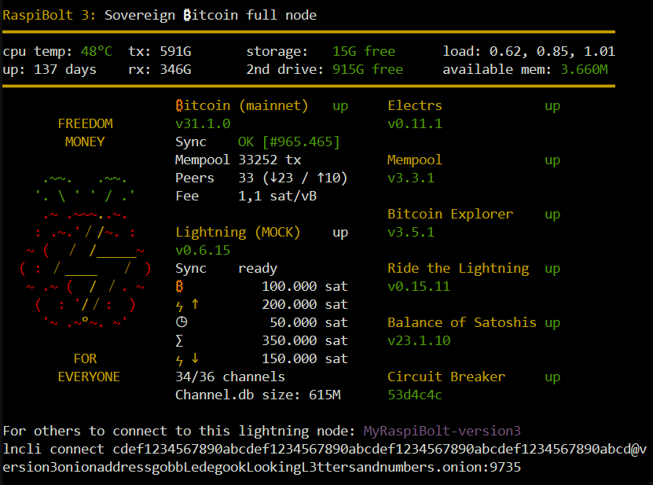
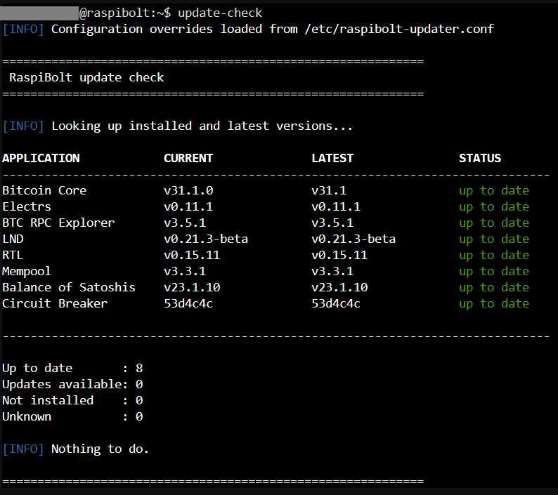
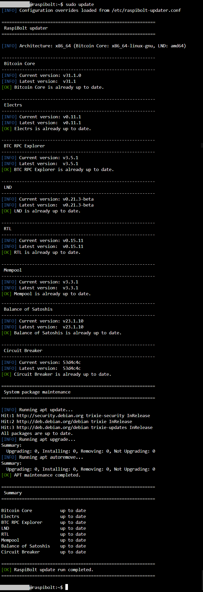

# RaspiBolt Helper

Status banner and update helpers for a **hand-installed RaspiBolt node** --
Bitcoin Core, LND, Electrs, BTC RPC Explorer, RTL, Mempool, Balance of
Satoshis and Circuit Breaker, each installed by following the official
[raspibolt.org](https://raspibolt.org/) guides, each running as its own
dedicated Linux user with its own home directory. No Docker involved.



> **Use at your own risk.** These scripts automate steps you would
> otherwise copy and paste from the RaspiBolt guides by hand. That
> removes a class of typo, but it does not remove your responsibility:
> read the release notes, keep a channel backup, and understand that an
> update to a Lightning node can cost you money if it goes wrong. Nobody
> but you is liable for what happens to your node.

## What's in here

```text
raspibolt-motd.sh            login banner / status overview   ->  raspibolt
raspibolt-updater-check.sh   read-only installed vs. latest    ->  update-check
raspibolt-updater.sh         guided, interactive updater       ->  update
raspibolt-updater.conf.example   optional site-local overrides
```

### `raspibolt` -- the status banner

Shown automatically when you log in over SSH, and on demand any time you
type `raspibolt`. One screen with everything worth knowing about the node:

- system health: CPU temperature, uptime, load, memory, free space on the
  blockchain drive and a second drive, network traffic in/out
- every service, colour-coded `up` / `down`, with its installed version --
  and, when a newer release exists upstream, `v0.11.1 > v0.12.0` so you
  can see at a glance that there is something to do
- Bitcoin Core: sync state, block height, mempool size, peer count split
  into inbound/outbound, and the current fee rate in sat/vB
- LND: chain and graph sync, local **and inbound** liquidity, pending and
  unconfirmed balances, channel count and `channel.db` size
- your node's `lncli connect` URI, ready to hand to a peer
- a randomly chosen Bitcoin phrase over the coin art, because a node
  should have a little personality

Upstream version lookups are cached in `~/.raspibolt.versions.json` and
refreshed at most every 6 hours, so a login never waits on GitHub and you
stay well clear of the unauthenticated API rate limit.

This started as RaspiBolt's own
[system overview](https://github.com/raspibolt/raspibolt/blob/v3-final/guide/bonus/raspberry-pi/system-overview.md)
banner and grew from there: all of the bonus services above, upstream
version comparison, inbound liquidity, the current fee rate, the phrase
art, and a non-root code path (see [Permissions](#permissions)).

### `update-check` -- what would change

Read-only. Makes no changes at all. Prints one table comparing what is
installed against what is available upstream, then a one-line summary:

```text
APPLICATION            CURRENT              LATEST               STATUS
------------------------------------------------------------------------
Bitcoin Core           v31.1.0              v31.1.0              up to date
Electrs                v0.11.1              v0.12.0              update available
...

Up to date       : 6
Updates available: 1
Not installed    : 1
Unknown          : 0
```

<!-- Save a terminal screenshot of `update-check` as docs/images/update-check.png -->


### `update` -- the guided updater

Walks every application in turn. Where a newer version exists it shows you
what it found and asks before touching anything; answer `n` and it moves
on to the next one. Finishes with `apt update` / `upgrade` / `autoremove`.

- **Bitcoin Core and LND** are prebuilt release tarballs: downloaded,
  SHA256-checked and GPG-verified before their binaries replace the ones
  in `/usr/local/bin` (the old ones are kept as `.old`). LND additionally
  prompts you to confirm you have read the release notes and have a
  current channel backup.
- **Everything else** is a Git checkout: `git fetch` + `git checkout <tag>`
  and a rebuild (`cargo` / `npm` / `go`), each run as that application's
  own Linux user, exactly as a human following the guide would. Circuit
  Breaker has no upstream tags, so it tracks `master` by commit.
- A hard failure inside one application -- bad checksum, failed build, a
  service that will not come back up -- **stops the script** rather than
  carrying on to the next one. Re-running is safe: anything already on the
  latest version is skipped.

<!-- Save a terminal screenshot of `update` as docs/images/update.png -->


## Requirements

Debian/Ubuntu (developed against Debian 13 "Trixie" in a Proxmox LXC), a
RaspiBolt install following the official guides, plus:

```bash
sudo apt install curl jq bc bsdextrautils   # bsdextrautils provides `column`
```

The updater additionally uses `git`, `gpg`, `tar` and `sha256sum`, and the
per-app toolchains (`cargo`, `npm`, `go`) that the guides already had you
install.

## Installation

Everything below is run from your normal **`admin`** account (the
unprivileged user the RaspiBolt guide has you create) -- not as root.

```bash
cd /tmp
git clone https://github.com/satcat21/raspibolt-helper.git
cd raspibolt-helper

sudo install -m 755 raspibolt-motd.sh          /usr/local/bin/raspibolt
sudo install -m 755 raspibolt-updater-check.sh /usr/local/bin/update-check
sudo install -m 755 raspibolt-updater.sh       /usr/local/bin/update
```

`/usr/local/bin` is already on the default `PATH`, so all three commands
now work from any directory. Verify:

```bash
raspibolt --help
```

### Show the banner on SSH login

`/etc/update-motd.d/` runs its scripts as root at login, in filename
order. Symlink the banner in so it is updated along with the command:

```bash
sudo ln -s /usr/local/bin/raspibolt /etc/update-motd.d/20-raspibolt
```

Debian's stock MOTD parts are noisy next to this; disable the ones you do
not want by removing their execute bit, e.g.
`sudo chmod -x /etc/update-motd.d/10-uname`. Log out and back in to see
the result. If nothing appears, check that `PrintMotd no` is set in
`/etc/ssh/sshd_config` (the default -- PAM prints the dynamic MOTD, and
`PrintMotd yes` would print the static one twice instead).

### Permissions

`update` and `update-check` **require root**: they read into other service
users' home directories (mode `750`), and for Git-based apps run `git` as
the owning user via `sudo -u <appuser>` -- Git refuses to operate on a
repository owned by someone else ("detected dubious ownership") when
invoked directly as root without that. `update` additionally needs root
for `apt`, `systemctl` and writing into `/usr/local/bin`.

`raspibolt` is happiest as root (that is how the MOTD hook runs it) but no
longer requires it. Run by an unprivileged user it cannot use `sudo -u
<appuser>` -- sudo would demand a password mid-banner, and with stderr
discarded you would only see the app reported as missing -- so it runs
those commands directly instead and reports as "not installed" whatever it
genuinely cannot reach. To get the full picture without root, add your
admin account to the groups of the apps whose files it would otherwise not
be allowed to read:

```bash
sudo usermod -aG bos,mempool,circuitbreaker admin
```

Group changes only take effect at the next login; check with `id -nG` that
they are actually active in your session.

### Running `raspibolt` and `update-check` without typing `sudo`

Both are read-only (no config changes, no restarts, no package installs),
so it is reasonable to let your admin user run them without a password
prompt every time -- via a `NOPASSWD` rule scoped to exactly those two
paths, not a blanket sudo grant.

1. Create the rule (replace `admin` with your actual username):

   ```bash
   sudo visudo -f /etc/sudoers.d/raspibolt-updater
   ```

   ```text
   admin ALL=(root) NOPASSWD: /usr/local/bin/update-check, /usr/local/bin/raspibolt
   ```

2. Alias both commands to go through `sudo` transparently, in your
   `~/.bashrc`:

   ```bash
   echo "alias update-check='sudo /usr/local/bin/update-check'" >> ~/.bashrc
   echo "alias raspibolt='sudo /usr/local/bin/raspibolt'" >> ~/.bashrc
   source ~/.bashrc
   ```

Now plain `update-check` and `raspibolt` (no `sudo`, no password prompt)
run as root under the hood via those two whitelisted commands.

Do **not** do the same for `update`: a `NOPASSWD` rule for that one is
effectively root-equivalent, since it runs `apt`/`systemctl` and writes
into `/usr/local/bin`. Typing your password for that one is intended.

## Local configuration (optional)

Both updater scripts carry tables describing the stock RaspiBolt layout:
source directories, the Linux user that owns each source tree, and systemd
service names. Where your install differs, put the overrides in a config
file instead of editing the scripts, so a script update cannot clobber
them and the updater and the checker cannot drift apart:

```bash
sudo install -m 600 -o root -g root \
    raspibolt-updater.conf.example /etc/raspibolt-updater.conf
```

Both scripts source it after their own defaults, so it can assign straight
into their tables; everything in it is optional, and with no config file
present they behave exactly as they do out of the box. It is sourced by a
script running as root, so it is refused unless root owns it and nobody
else can write it. Set `RASPIBOLT_UPDATER_CONF` to read it from somewhere
other than `/etc/raspibolt-updater.conf`.

```bash
APP_SRC_DIR[mempool]="/opt/mempool"
APP_SERVICE[rtl]="ridethelightning"
APP_BUILD_USER[electrs]="admin"
```

The banner has its own service-name variables (`sn_bitcoin`, `sn_rtl`,
`sn_mempool`, ...) near the top of `raspibolt-motd.sh`; it also supports
CLN, Fulcrum and Thunderhub, which the updater does not.

## Architecture

Only Bitcoin Core and LND install prebuilt binaries; everything else is
compiled on the machine and is architecture-agnostic. The updater derives
the right download for both from `uname -m`:

| `uname -m` | Bitcoin Core tarball | LND asset |
|---|---|---|
| `x86_64` | `bitcoin-<ver>-x86_64-linux-gnu.tar.gz` | `lnd-linux-amd64-<ver>.tar.gz` |
| `aarch64` | `bitcoin-<ver>-aarch64-linux-gnu.tar.gz` | `lnd-linux-arm64-<ver>.tar.gz` |

So an amd64 host gets the amd64 build without any configuration, even
though the RaspiBolt guides are written for a Raspberry Pi. Detection
cannot go stale the way a written-down value can, so prefer it. For the
cases it cannot answer -- a 32-bit userland on a 64-bit kernel, or an
architecture not in the table above, where the updater stops and says so
-- `BITCOIN_ARCH` and `LND_ARCH` in the config file override it.

## LND release signatures

LND releases are signed by a rotating subset of maintainers rather than by
one fixed key, and not every maintainer signs every release. The updater
therefore walks `LND_SIGNERS`, takes the first
`manifest-<signer>-<version>.sig` that exists for the release, fetches
that signer's key from upstream `scripts/keys/<signer>.asc` if it is not
already in root's keyring, and verifies against it. If no signature
verifies, it says which signers it tried and asks whether to proceed on
the SHA256 checksum alone. Restrict the list in the config file to verify
only against signers you personally trust.

## Credits

The banner began as the RaspiBolt project's
[system overview](https://github.com/raspibolt/raspibolt/blob/v3-final/guide/bonus/raspberry-pi/system-overview.md)
script and keeps its spirit and layout. All credit for the original goes
to the RaspiBolt authors; everything that broke along the way is mine.

## License

MIT
